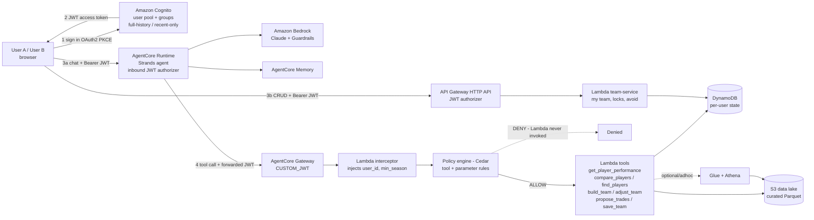

# 02 — Architecture (v0.1, 2026-10-08)

Standalone picture: [architecture_v0.1.svg](architecture_v0.1.svg). Mermaid versions below render on GitHub / VS Code.

Items marked **[verify]** rest on AWS features I have only partly confirmed (AgentCore moves fast); each maps to a spike in `04_RUNBOOK_PHASE0.md`.

## 1. Component view



## 2. Request flows

**A. Chat: "Compare Nick Daicos and Harry Sheezel — who has the better ceiling?"**
1. SPA obtains a Cognito access token (Hosted UI, authorization-code + PKCE; public client — no client secret in the browser).
2. SPA calls the AgentCore Runtime with `Authorization: Bearer <JWT>`. The Runtime validates the JWT (discovery URL + allowed client) and the `Authorization` header is passed to the agent code via the runtime request-header allowlist **[verify S1]**.
3. The agent (Strands, Bedrock Claude) decides to call `compare_players`. The tool call goes to the Gateway MCP endpoint carrying the *same* JWT.
4. Gateway validates the JWT, runs the **interceptor** (resolves `sub` → entitlement `min_season`, overwrites `user_id`/`min_season` arguments — whatever the LLM sent is ignored) **[verify S3]**, then the **Cedar** policy engine evaluates tool + parameters.
5. ALLOW → Lambda runs with its own IAM role (read-only to the curated S3 prefix), returns structured stats (avg, floor, ceiling, consistency, availability, per-season table). DENY → the Lambda is never invoked and the agent receives a refusal it must relay.
6. Agent writes the comparison from the tool output only; the system prompt forbids un-sourced numbers.

**B. Chat: "Build my AFL Fantasy starting team"**
`build_team(competition, constraints)` → container Lambda loads shared projections, applies guardrails, runs the PuLP solver, stores a *preview* in DynamoDB keyed `USER#sub / PREVIEW#id` with a short TTL, returns squad + validation report. Agent presents it. User says "looks good" → `save_team(preview_id)` writes `USER#sub / TEAM#fantasy#2027`. Fine-tuning ("swap X for a cheaper consistent mid") → `find_players` + `adjust_team` (re-validates cap/positions/guardrails every time).

**C. "My Team" page (no LLM):** SPA → API Gateway (JWT authorizer) → `team-service` Lambda → DynamoDB. `sub` comes from the authorizer context, never from the URL/body.

## 3. Authorization model (maps to your `SecurityArchitecture.png`)

| Layer | Question answered | Mechanism | Enforced where |
|---|---|---|---|
| Identity | Who is it? | Cognito → JWT (`sub`, `client_id`, `cognito:groups`) | Runtime + Gateway authorizers |
| Entitlement | What tier are they? | Group + DynamoDB `users` item (`min_season`, caps) | Interceptor (and re-checked in Lambda) |
| Policy | May this tool run with these parameters? | Cedar: group→tool allow-list; `season >= min_season`; `user_id == principal` **[verify S2]** | Gateway policy engine (start LOG_ONLY, then ENFORCE) |
| Tool | Do the work | Lambda, least-privilege role | Lambda |
| Data | What can the tool read? | IAM role scoped to prefixes/table keys (`dynamodb:LeadingKeys`) | IAM |

Defence in depth: even if the LLM is prompt-injected, (1) it cannot choose `user_id`, (2) Cedar blocks out-of-tier seasons, (3) the Lambda re-applies `min_season` and the key prefix, (4) users have no IAM path to data. Business rules are never in the prompt.

## 4. Data architecture

```
s3://<S3_BUCKET>/            (reuse existing bucket; separate prefixes)
  raw/                         (as-is uploads; not read by tools)
  processed/                   (existing: player-master, player-match-stats, player-identity)
  curated/                     (NEW: what tools read; schema-versioned)
    player_match/year=YYYY/
    player_master/year=YYYY/
    player_identity/
    player_season_summary/year=YYYY/    (avg, p20 floor, p90 ceiling, CV, games%, price)
    projections/year=YYYY/round=R/
    fixtures/year=YYYY/
    prices/{fantasy,supercoach}/year=YYYY/round=R/
```

DynamoDB (single table `afl_app`, on-demand):

| PK | SK | Holds |
|---|---|---|
| `USER#<sub>` | `PROFILE` | tier, `min_season`, daily token cap |
| `USER#<sub>` | `TEAM#<comp>#<year>` | squad (players by `PlayerId`), bank, meta |
| `USER#<sub>` | `LOCK#<comp>#<PlayerId>` / `AVOID#…` | locks/avoid list (replaces `premium_locks_*.csv`, `player_avoid_list*.csv`) |
| `USER#<sub>` | `TRADE#<comp>#<year>#<n>` | trade log |
| `USER#<sub>` | `PREVIEW#<id>` | unsaved solver output (TTL) |

Player identity: every curated row carries the internal `PlayerId`; `(name, team)` stays as display/disambiguation, never the join key.

## 5. Offline pipeline (Phase 1: stays local)

Scrape → clean → features → model stays on your machine (`app/src/common/*`), then a `publish_to_aws` step validates the schema and syncs the curated outputs to S3. Moving scraping/modelling into EventBridge + Step Functions + Fargate/Lambda is P7 and only worth it once in-season refresh cadence demands it.

## 6. Cross-cutting

- **Observability:** AgentCore observability + CloudWatch logs/metrics, X-Ray traces, a dashboard for tool latency/denials/token use. Denied-by-policy count is a first-class metric.
- **Guardrails:** Bedrock Guardrails on the agent (off-topic, PII, prompt-attack filter). *Not* the same as the app's `guardrails.yaml` (age/avoid rules), which stays deterministic inside the team tools.
- **Secrets:** none in code; Cognito client secrets/OAuth provider secrets in AgentCore credential providers / Secrets Manager.
- **Cost controls:** AWS Budgets, per-user daily caps, `maxIterations`/`maxTokens`, prompt caching, Lambda right-sizing.
- **Network:** everything public-endpoint + IAM/JWT for now; VPC only if a private resource appears (none planned).

## 7. Not in v0.1 (deliberately)

DFS lineup optimiser, draft-prospect dossier, tipping model, in-AWS scraping/training, multi-region, custom domain/WAF (add at P6/P7).
